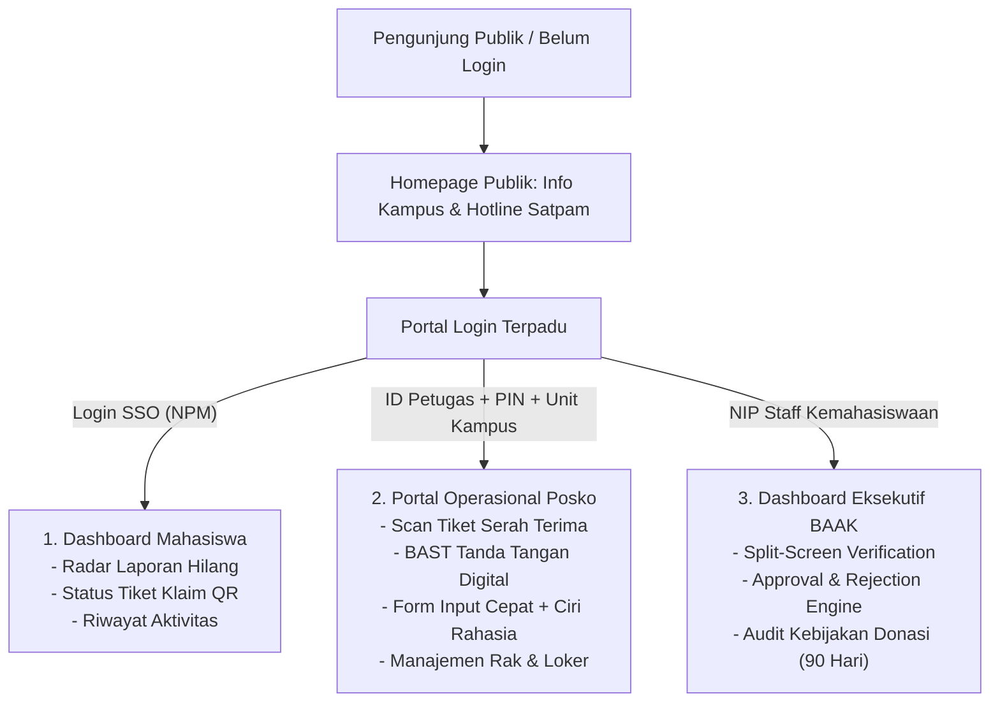

# PRODUCT REQUIREMENT DOCUMENT (PRD)
## SISTEM INFORMASI LOST AND FOUND TERPADU UNIVERSITAS GUNADARMA

---

| Dokumen | Keterangan |
| :--- | :--- |
| **Nama Proyek** | UG Lost & Found (Sistem Informasi Pengelolaan Barang Hilang & Temuan) |
| **Instansi Target** | Universitas Gunadarma (Kampus D, E, G, H, J1-J5, K, Simatupang) |
| **Versi Dokumen** | 1.0.0 |
| **Target Platform** | Web Responsive / Mobile-First PWA |
| **Status** | *Approved for Development* |

---

## 1. Executive Summary & Latar Belakang

### 1.1 Latar Belakang
Universitas Gunadarma merupakan perguruan tinggi dengan banyak unit kampus yang tersebar di wilayah Depok, Bekasi, Jakarta, dan Tangerang. Setiap harinya, puluhan barang milik mahasiswa (elektronik, dokumen/KTM, kunci kendaraan, tumbler, jaket) tertinggal di area publik maupun fasilitas terjadwal (laboratorium komputer dan ruang kuliah).

Saat ini, penanganan barang hilang masih memiliki kelemahan:
1. **Penyebaran Informasi Tidak Terstruktur:** Pengumuman barang hilang tersebar secara acak di media sosial tidak resmi (menfess Twitter/X, grup WhatsApp kelas), yang cepat tertimbun pesan lain.
2. **Ketiadaan Verifikasi Kepemilikan (*Anti-Fraud*):** Foto barang sering dipublikasikan secara utuh, memungkinkan oknum yang berniat buruk melakukan klaim palsu (*claim sniping*).
3. **Ketidaksesuaian Shift Jaga Satpam:** Barang temuan menumpuk di pos satpam tanpa pelabelan yang jelas mengenai letak rak/loker, nomor registrasi, atau identitas penemu.
4. **Ketiadaan Legalitas Serah Terima:** Tidak ada pencatatan resmi saat barang diambil, sehingga menimbulkan risiko tuduhan salah serah terima bagi petugas keamanan.

### 1.2 Tujuan Produk (*Objectives*)
* Membangun platform terpadu lintas-kampus UG yang menghubungkan **Mahasiswa**, **Petugas Keamanan Posko (Satpam)**, **Asisten Laboratorium**, dan **Biro Kemahasiswaan (BAAK)**.
* Mencegah klaim palsu menggunakan metode **Blind-Validation** dan **Penyensoran Otomatis Dokumen Identitas**.
* Mengotomatisasi pencocokan laporan kehilangan dengan data temuan melalui algoritma **Smart Reverse-Matching**.
* Menyediakan bukti serah terima berkekuatan hukum menggunakan **Tiket QR Resmi & Berita Acara Serah Terima (BAST) Ber-Tanda Tangan Digital**.

---

## 2. Stakeholders & User Persona

| Peran | Deskripsi | Kebutuhan Utama |
| :--- | :--- | :--- |
| **Mahasiswa (Pelapor / Pengklaim)** | Mahasiswa aktif UG yang kehilangan atau menemukan barang di lingkungan kampus. | Mencari barang dengan filter kampus/ruang, membuat laporan kehilangan, menjawab pertanyaan validasi, dan menerima tiket pengambilan. |
| **Petugas Posko (Satpam)** | Personil keamanan yang bertugas di pos satpam utama kampus (Kampus D, E, J1, K, dll.). | Input temuan cepat di selasar/parkiran, cetak label rak loker, scan tiket QR, verifikasi fisik, dan rekam tanda tangan mahasiswa. |
| **Asisten Laboratorium (Aslab)** | Petugas piket ruang praktikum komputer / i-Lab (Kampus H, E, D, J). | Input temuan spesifik berdasarkan shift praktikum, mata kuliah, dan nomor meja PC. |
| **Admin BAAK / Kemahasiswaan** | Pejabat berwenang tingkat universitas yang melakukan verifikasi data tingkat lanjut. | Layar perbandingan (*split-screen*) jawaban mahasiswa vs catatan fisik satpam, persetujuan klaim, audit barang kadaluarsa/donasi. |

---

## 3. Product Architecture & Multi-Portal Design

Aplikasi menggunakan arsitektur **Role-Specific Gateway** dengan halaman utama (*homepage*) yang berbeda untuk tiap jenis pengguna:



---

## 4. Fitur Utama & Spesifikasi Solusi

### 4.1 Mekanisme Pencegahan Klaim Palsu (*Anti-Fraud Blind-Validation*)
Untuk mengatasi kelemahan katalog publik:
* **Penyensoran Foto Dokumen:** Dokumen resmi (KTM, KTP, SIM, STNK) secara otomatis diburamkan (*blur 80%*) di katalog publik.
* **Pemisahan Atribut Publik vs Rahasia:**
  * *Atribut Publik:* Merk, jenis barang, kampus ditemukan, tanggal ditemukan.
  * *Atribut Rahasia (*Secret Features*):* Catatan fisik rahasia yang hanya dicatat oleh petugas (misal: isi saldo dompet, warna gantungan dalam tas, stiker di balik cover laptop, nama folder tugas akhir di flashdisk).
* **Ujian Pertanyaan Terbuka:** Pengklaim wajib mendeskripsikan ciri rahasia tersebut tanpa diberi petunjuk pilihan ganda.

### 4.2 Radar Pencocokan Cerdas (*Live Smart Reverse-Matching*)
Jika barang belum ditemukan saat mahasiswa mencari:
* Mahasiswa mengisi formulir laporan kehilangan (*Lost Report*).
* Sistem menjalankan algoritma pembobotan real-time:
  $$\text{Match Score} = (30\% \times \text{Kategori}) + (25\% \times \text{Kampus}) + (20\% \times \text{Tanggal}) + (25\% \times \text{Kemiripan Teks})$$
* Jika skor $\ge 70\%$, sistem menampilkan kandidat temuan dan mengirim notifikasi prioritas.

### 4.3 Alur Serah Terima Fisik & BAST Digital
Pemberian barang di posko satpam tidak lagi menggunakan secarik kertas yang mudah hilang:
1. Mahasiswa menunjukkan **QR Tiket Pengambilan** dari layar ponselnya.
2. Satpam memindai QR code menggunakan aplikasi posko.
3. Aplikasi menampilkan detail fisik dan nomor rak loker penyimpanan (misal: `RAK-B / BOX-02`).
4. Satpam memverifikasi fisik bersama mahasiswa (buka kunci PIN layar/sebutkan isi).
5. Mahasiswa membubuhkan **tanda tangan digital langsung pada kanvas layar**.
6. Satpam menyelesaikan transaksi, sistem mengubah status barang menjadi **`RETURNED`** (*Sudah Diambil*).

### 4.4 Kebijakan Retensi & Disposisi Barang (*Disposal Policy*)
* **Barang Makanan/Basah (*Perishable*):** Batas simpan maksimal $1 \times 24$ jam sebelum dimusnahkan.
* **Barang Aksesoris/Pakaian/Botol Minum:** Batas simpan 30 hari. Jika tidak bertuan, dialihkan menjadi paket donasi bakti sosial mahasiswa BEM Gunadarma.
* **Barang Elektronik & Berharga:** Batas simpan 90–180 hari sebelum dilakukan evaluasi pemutihan/lelang sosial untuk dana beasiswa kampus.
* **Dokumen Resmi (KTP/KTM/SIM):** Diserahkan ke loket BAAK pusat jika melewati 60 hari.

---

## 5. Kebutuhan Fungsional (*Functional Requirements*)

| ID | Modul | Deskripsi Kebutuhan | Prioritas |
| :--- | :--- | :--- | :---: |
| **FR-01** | Autentikasi | Sistem mendukung autentikasi SSO Mahasiswa (NPM), Petugas Lapangan, dan Admin BAAK dengan kredensial berbeda. | P0 (Must Have) |
| **FR-02** | Katalog Publik | Sistem menampilkan grid barang temuan dengan filter Kampus (D, E, G, H, J1, K), kategori, dan tipe area (Lab vs Publik). | P0 (Must Have) |
| **FR-03** | Sensor Privasi | Sistem secara otomatis menyamarkan foto dokumen sensitif pada katalog publik. | P0 (Must Have) |
| **FR-04** | Form Klaim | Sistem mewajibkan pengklaim menjawab pertanyaan ciri khusus rahasia dan melampirkan berkas bukti pendukung. | P0 (Must Have) |
| **FR-05** | Reverse Matching | Sistem menghitung skor kecocokan antara form laporan kehilangan mahasiswa dengan inventaris barang temuan posko. | P1 (High) |
| **FR-06** | Input Posko | Petugas satpam/aslab dapat mencatat temuan barang dengan field lokasi, titik simpan loker, dan catatan rahasia penguji. | P0 (Must Have) |
| **FR-07** | Tiket QR | Sistem menerbitkan QR Code unik sebagai tiket pengambilan fisik setelah klaim disetujui BAAK. | P0 (Must Have) |
| **FR-08** | BAST Kanvas | Sistem menyediakan modul kanvas tanda tangan digital pada perangkat posko saat proses serah terima barang. | P0 (Must Have) |
| **FR-09** | Split Verification | Dashboard admin menyediakan layar komparasi berdampingan antara data klaim mahasiswa vs catatan rahasia satpam. | P0 (Must Have) |
| **FR-10** | Audit Disposisi | Sistem menandai barang yang mendekati atau melampaui tanggal kadaluarsa penyimpanan (*expiry date*). | P2 (Medium) |

---

## 6. Kebutuhan Non-Fungsional (*Non-Functional Requirements*)

1. **Responsivitas Antarmuka:** Antarmuka harus optimal digunakan di ponsel pintar layar 360px (satpam di posko) hingga monitor layar lebar 1920px (admin di ruang kantor BAAK).
2. **Kinerja & Kecepatan:** Waktu respon pencarian dan filter katalog $\le 1$ detik untuk dataset hingga 10.000 item.
3. **Integritas Audit Log:** Setiap perubahan status barang (*SAVED* $\rightarrow$ *IN_CLAIM* $\rightarrow$ *APPROVED* $\rightarrow$ *RETURNED*) wajib tercatat pada tabel log audit dengan pencatatan waktu dan ID aktor.
4. **Keamanan Data:** Informasi rahasia (*secret_features*) tidak boleh dikirimkan ke endpoint API publik untuk mencegah eksploitasi inspeksi elemen browser (*Inspect Element/DevTools*).

---

## 7. Skema Basis Data Relasional (*Database Schema Summary*)

```text
[CAMPUSES] 1 --- * [LOCATIONS] 1 --- * [FOUND_ITEMS] 1 --- * [ITEM_PHOTOS]
                                              |
[CATEGORIES] 1 -------------------------------|
                                              | 1
                                              |
[USERS] 1 --- * [LOST_REPORTS]                * [CLAIMS] 1 --- 1 [CLAIM_VERIFICATIONS]
  |                                                |
  +----------- 1 --- * [AUDIT_LOGS] <--------------+
```

* **`USERS`:** Menyimpan akun mahasiswa, satpam posko, aslab, dan admin BAAK.
* **`FOUND_ITEMS`:** Entitas utama barang temuan beserta status loker dan `secret_features`.
* **`LOST_REPORTS`:** Laporan barang hilang mahasiswa untuk mesin pencocokan (*radar*).
* **`CLAIMS`:** Pengajuan klaim kepemilikan beserta jawaban ciri rahasia dan tiket QR.
* **`CLAIM_VERIFICATIONS`:** Catatan BAST digital lengkap dengan foto serah terima dan tanda tangan digital.

---

## 8. Rekomendasi Tech Stack

* **Frontend:** React 19 / Next.js (App Router), Tailwind CSS (Identitas visual: Ungu `#5E2750` & Gold `#E5A93C`), Lucide React Icons.
* **Canvas Engine:** HTML5 Canvas API untuk digital signature pad BAST.
* **Backend:** Node.js (Express / Next.js Server Actions / NestJS).
* **Database:** PostgreSQL (dengan ekstensi `pg_trgm` untuk pencarian kemiripan teks full-text).
* **Storage Asset:** AWS S3 / Cloudinary / Supabase Storage (untuk foto barang dan bukti KTM).
